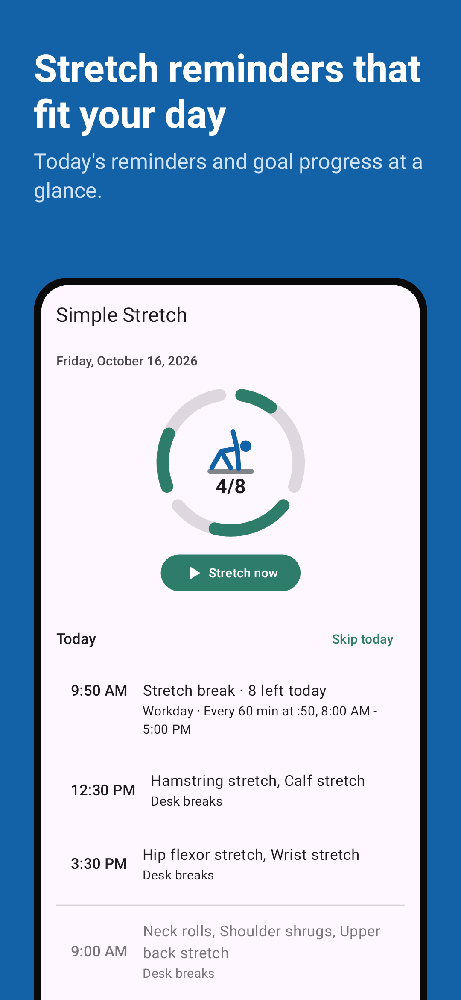
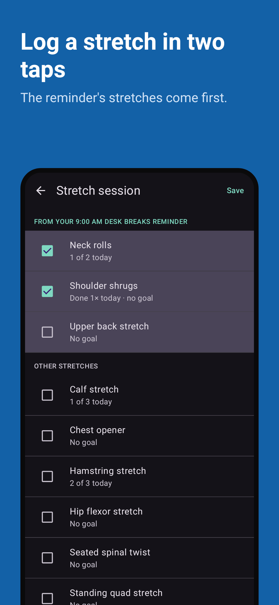
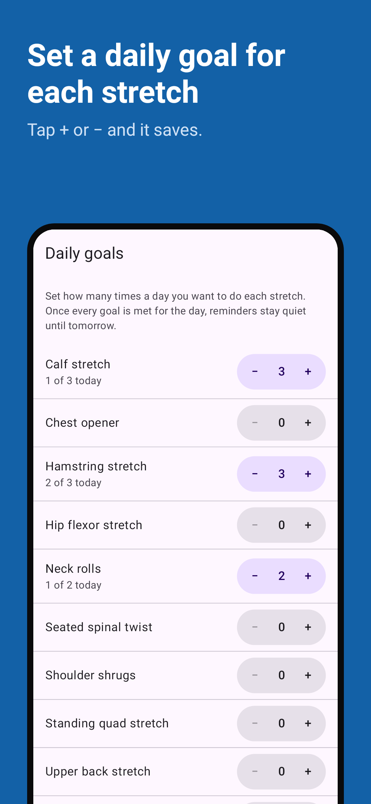
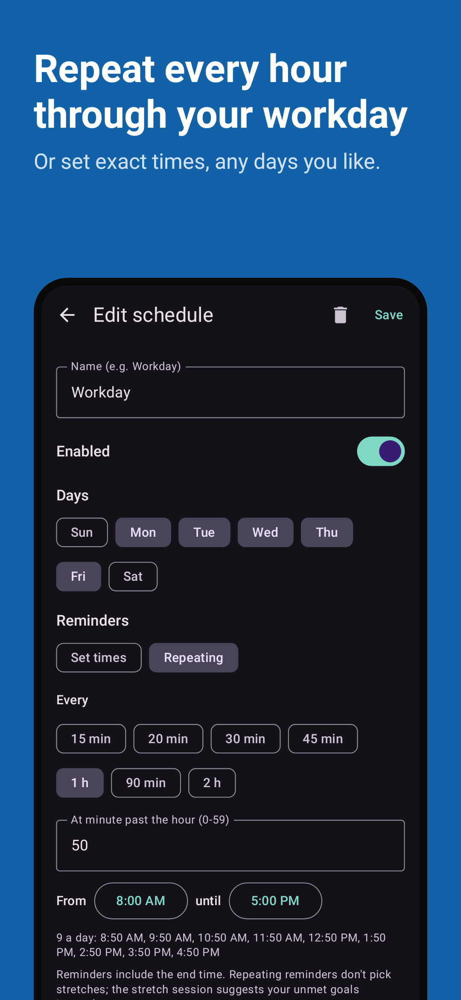
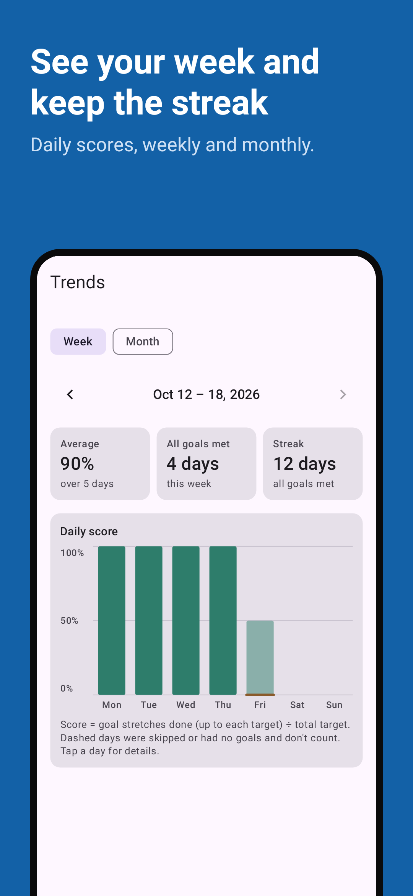
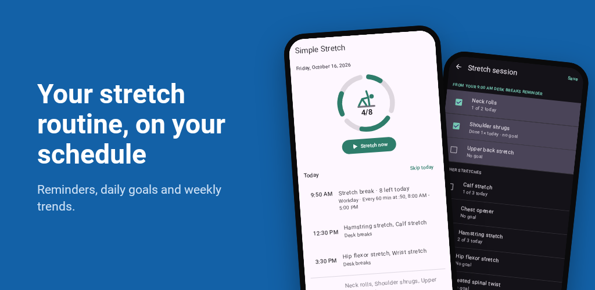

# Store images

The images of the Google Play listing, as committed: the five phone screenshots in listing order,
the store icon and the feature graphic. They are the files under
`fastlane/metadata/android/en-US/images/` themselves, linked by their real paths (on the docs
site, through a symlink to the same folder), so a re-recording updates this page with no extra
step (STORE-DOCS-001). How each image is made is in the
[store listing specification](../spec/store-listing.md); the screenshot captions and the feature
graphic's text are in [Store screenshot captions](captions.md).

## Phone screenshots

### 1. Home (STORE-SHOT-001)

### 2. Stretch session (STORE-SHOT-002)

### 3. Goals (STORE-SHOT-003)

### 4. Schedule (STORE-SHOT-004)

### 5. Trends (STORE-SHOT-005)

## Store icon (STORE-ICON-001)

## Feature graphic (STORE-GRAPHIC-001)

